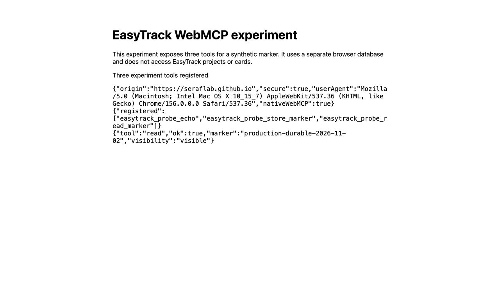

# MCP production-origin browser gate — 2026-11-01

Initial loopback status: **FAILED**. Native WebMCP alternative: **PASS on production**, detailed below; actual task integration is pending. This records a real Codex internal-browser experiment, not a localhost substitute. No MCP task operations were implemented or advertised.

## Environment and published prerequisite

- Production origin: `https://seraflab.github.io`, document `/tracker/mcp-transport-probe.html`.
- Prerequisite PR20: merged `5159b6b`, deployment and smoke succeeded. PR21 fixes service-worker navigation fallback for this concrete document, merged `395f19e`; deployment and smoke succeeded.
- The existing browser accepted EasyTrack's ordinary **Update** action. Browser storage and the service worker were not cleared or unregistered.
- Browser-reported user agent: `Mozilla/5.0 (Macintosh; Intel Mac OS X 10_15_7) AppleWebKit/537.36 (KHTML, like Gecko) Chrome/156.0.0.0 Safari/537.36`. The host application version was not exposed by the available browser APIs.
- Local Node `24.21.0`, `ws` `8.22.1`. Relay binds only `127.0.0.1`, uses an ephemeral port/token, exact Origin/Host/path checks and a 15-minute lifetime.

## Observed results

1. The actual published HTTPS document loaded in the same IAB context, removed its bootstrap fragment, and reported `secure: true`, the production origin, and IndexedDB `storage: ready`.
2. **Test connection** was activated in a hidden tab, then repeated in a visible tab with a fresh relay session. Both reported `Local connection failed; handshake not confirmed`, `handshake: false`, close code `1006`.
3. No browser permission prompt was exposed in the accessibility state or screenshot. Console warning/error collection returned no entries. This evidence does not identify the precise browser policy responsible.
4. Direct navigation to the relay's HTTP loopback address returned the relay's `Upgrade Required` response. The local process was reachable from IAB over HTTP.
5. A final isolated relay copy added sanitized HTTP-upgrade diagnostics without weakening any check. The production-page WebSocket attempt never reached its `verifyClient` handler; no upgrade attempt was recorded. This rules out rejection by the relay's token/Origin/Host validation for that observed attempt.
6. Consequently there was no authenticated handshake, no background command, and no marker write to verify across reopening. Task 1.2 is also unfulfilled. Local Playwright regressions pass but do not change this production result.

## Browser-tool workflow and limits

`cua.createBrowserTab('2', url, { visible: false/true })` opened hidden and visible internal tabs; `getAXState`, native `click`, `getAXStateAndScreenshot`, and the visibility capability supported inspection and ordinary app update. Old tab bindings from an earlier user turn were stale and were replaced with newly created tabs in the same browser. No external browser or alternate storage origin was substituted.

The browser offers document-bound WebMCP discovery, but this diagnostic document has no registered tools. Whether a native page-tool alternative can satisfy a revised integration contract requires a separate feasibility test and a product decision; it is not evidence that stdio MCP or WebMCP integration is working.

## Next decision

The existing design explicitly requires a successful production handshake before core MCP implementation. Keep the change active and stop dependent groups 2–6 until the transport is revised with the user or the existing path demonstrably works. Do not mark the gate complete, replace it with localhost evidence, disable browser security, or claim a task was saved through MCP.

## Selected alternative: native WebMCP — 2026-11-02

The user selected testing page-defined WebMCP tools after the WebSocket result above. The isolated prerequisite PR23 merged as `ae3dd324792c596609983c08ee778e00b3322928`; its deployment and smoke checks succeeded. Native local feasibility was repeated at the unchanged production origin after an ordinary EasyTrack worker update.

**Native production feasibility: PASS.** The actual IAB (same Chrome156 user agent above) registered three tools at `https://seraflab.github.io/tracker/webmcp-probe.html`; browser discovery returned their schemas and document-bound names. The agent invoked echo and `store_marker`, receiving `ok:true` and `saved:true`. The browser visibility capability remained `false` after the call. The document itself reported `visibilityState: visible`; no claim is made about execution in a document reported as hidden.

The original experiment tab was closed. A newly opened document registered fresh tool handles; `read_marker` returned the exact synthetic value `production-durable-2026-11-02`. This proves execution and IndexedDB continuity in the selected production browser context. The experiment uses only the separate `easytrack-webmcp-experiment` database; it neither accesses project data nor implements the actual task tools. No browser protection, flag, origin-trial token, global MCP setting, or external browser was used.

Actual calls used the browser's `webmcp.fetchTools()` and the returned `tools.call(name,input)` handles, not DOM CRUD or injected application functions. Native proof is separate from the explicit model-context fixtures in automated tests.

The feasibility obstacle is resolved for this host. Replacing the original stdio/relay public integration contract with browser-native page tools requires the explicit user decision and coherent OpenSpec revision; the agent-access feature is not yet implemented or delivered.
